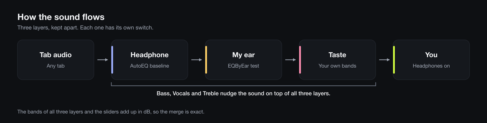
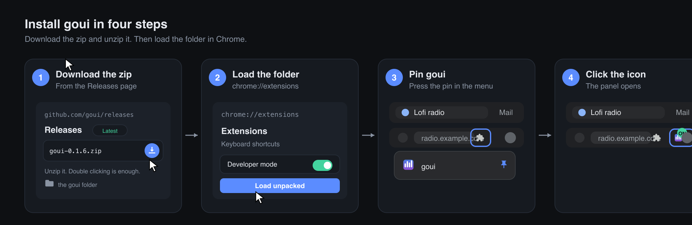
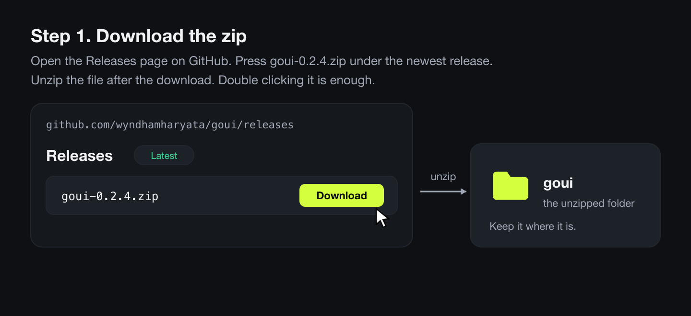
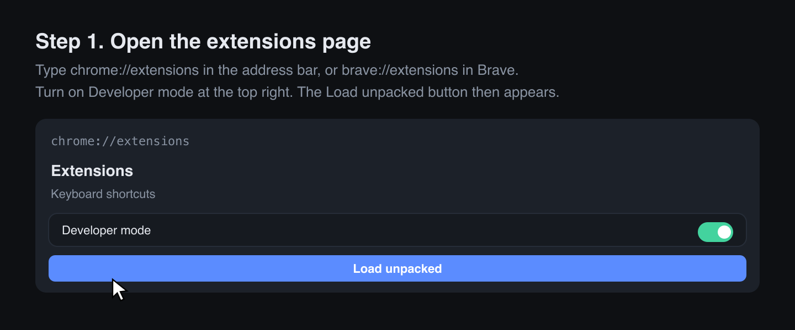
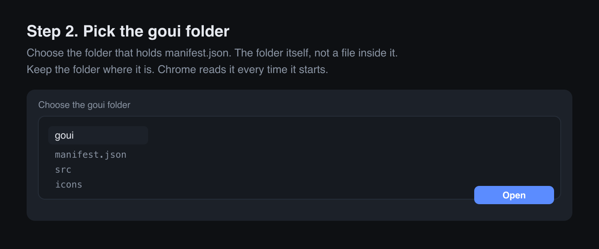
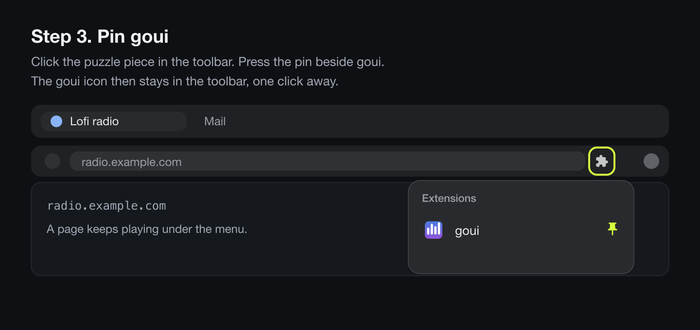
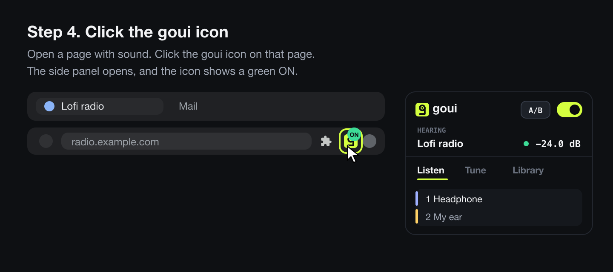

# goui

A parametric EQ for one browser tab or the whole Mac. It tunes audio to your headphone, then to
your ear, then to your taste.

## Install

> The screenshots show `main`. The Chrome Web Store currently has release 0.1.8, which uses the
> older blue icon and text.

### Chrome and Brave

<a href="https://chromewebstore.google.com/detail/goui/ghldfngciehgonecnnihpdeghejkndap"></a>

One click installs it. Chrome keeps it updated. To load the unpacked folder instead, see
[Add the extension by hand](#add-the-extension-by-hand).

### Mac

Paste this in Terminal:

```sh
curl -fsSL https://raw.githubusercontent.com/wyndhamharyata/goui/main/mac/install.sh | sh
```

Requires Apple silicon and macOS 26 or later. Read [goui for the Mac](#goui-for-the-mac) first.

## Contents

- [Install](#install)
- [What it does](#what-it-does)
- [Add the extension by hand](#add-the-extension-by-hand)
- [The icon is the switch](#the-icon-is-the-switch)
- [goui for the Mac](#goui-for-the-mac)
- [Use it](#use-it): [Listen](#listen), [Tune](#tune), [Library](#library) and [Sets](#sets)
- [Measure your ear](#measure-your-ear)
- [Notes](#notes)
- [Credits](#credits)
- [Develop](#develop)

## What it does

goui combines AutoEQ and EQByEar. AutoEQ corrects your headphone or IEM. An EQByEar test tunes to
your hearing. Your taste goes on top as your own bands.

The browser extension runs one tab's audio through the EQ. The Mac app runs all system audio
through it. Both keep your headphone, ear and taste as three separate layers, each with its own
switch. Bass, Vocals and Treble adjust the sound across all three. All bands and sliders sum in dB.
A Set restores all three layers and the sliders at once.



## Add the extension by hand

To run the files directly instead of installing from the Chrome Web Store, download a release zip,
unzip it, and load the folder in Chrome.



### 1. Download the zip



Open the [Releases page](https://github.com/wyndhamharyata/goui/releases/latest). Download the
`goui-<version>.zip` file under the newest release and unzip it.

Keep the unzipped folder in place. Chrome reads it on every launch.

### 2. Load the folder in Chrome



Open `chrome://extensions` or `brave://extensions`. Turn on **Developer mode** at the top right and
press **Load unpacked**.



Select the unzipped `goui` folder (the one containing `manifest.json`).

### 3. Pin goui



Click the puzzle piece in the toolbar and pin goui.

### 4. Start listening



Open a tab playing audio and click the goui icon. The side panel opens.

A guide opens on first install. Press **?** in the panel to open it again.

## The icon is the switch

Chrome allows tab audio capture only after you click the extension icon on that tab.

- With the panel open, click the icon on the active tab to turn goui off. With the panel closed,
  clicking it reopens the panel.
- Click the icon on another tab to move goui there.
- Installed web apps (like YT Music) have no side panel. Clicking the icon opens goui as a popup
  with its own power button.
- The icon shows a green ON badge on the captured tab.
- Closing the captured tab turns goui off.

## goui for the Mac

The Mac app runs all system audio through the same panel from the menu bar. It requires Apple
silicon and macOS 26 or later.

The installer checks your Mac and asks before installing. No admin password is required. It places
`goui.app` in `~/Applications`, registers a login item, and opens the panel. On first start, macOS
asks permission to record system audio. Press **Allow**. goui processes the audio in real time and
stores none of it.

- Click the menu bar icon to toggle the panel. Right-click for **About goui**, **Restart engine**,
  **Reload panel**, **Wide panel**, **Sets**, update options and **Quit goui**.
- **Sets** lists saved Sets and marks the active one. Pick a Set to switch without opening the
  panel.
- goui follows the default output device. Other system EQs (such as eqMac or SoundSource) stack on
  top of goui. Run only one at a time.
- Spatial Audio and head tracking on AirPods and Beats pause while goui is active.
- goui is not signed with an Apple Developer ID yet. Engine updates will prompt for audio
  permission again. Settings stay in `~/Library/Application Support/goui`.
- Panel-only updates apply automatically. Engine updates show **Update to …** in the menu.
- goui checks GitHub for updates twice a day and sends no user data.
- The `goui` CLI supports `start`, `stop`, `restart`, `set "name"`, `logs`, `rollback` and
  `uninstall`.

See [goui.mwyndham.dev/mac](https://goui.mwyndham.dev/mac) for details and troubleshooting.

## Use it

The panel works the same in the browser and on the Mac. Hold **A/B** to hear the audio without EQ.
Use the top switch to turn the EQ on or off. The meter shows output in dB and turns red when the
EQ may clip.

### Listen

- **Set** loads a saved Set. **Save as Set** saves the current layers and sliders.
- **Headphone**, **My ear** and **Taste** each have an on/off switch. **Change** opens that layer
  in the Library. Pressing **×** resets Headphone to Flat or removes the ear and taste layers.
- AutoEQ headphones show a **Target** picker for their measurement rig. Switching targets reloads
  the headphone and replaces manual band edits.
- **Bass**, **Vocals** and **Treble** adjust the sound across all layers and persist when you switch
  presets.
- **Preamp** automatically offsets the highest boost to prevent clipping. Drag the slider to set it
  manually, or press **Auto** to restore automatic gain.
- **Level match** keeps the preamp active while holding **A/B** so you compare the curve at equal
  volume.

### Tune

- Click a point or chip to select a band. Drag a point to change frequency and gain (hold Shift for
  fine adjustment).
- Drag the side handles on a selected Peak band or scroll the mouse wheel over a point to adjust
  bandwidth (Q).
- Double-click empty space on the graph or press **Add band** in the chip rows to add a band.
- Use **All**, **Lows**, **Mids** and **Highs** to zoom the frequency axis. **Tall** rotates the
  graph.
- The inspector edits the selected band's type, frequency (1 semitone per step), gain (0.5 dB per
  step) and Q. **On** mutes or unmutes the band, **Solo** isolates it, and **Delete** removes it.
- **Number table** shows all bands in a table.

### Library

The Library has tabs for **Headphone**, **My ear**, **Taste** and **Sets**.

- **Save** stores the layer's bands as a preset. **Save changes** updates an edited preset.
  **Save as new** saves under a new name.
- The **Headphone** search box searches your saved presets, starter sounds and the AutoEQ database.
  When a model has multiple measurements, **AutoEQ's pick** marks the recommended entry.
- **Import** loads a `ParametricEQ.txt` file. **Paste** reads AutoEQ text from a text box.
  **Export** outputs the current layer as AutoEQ text.
- **Measure my ear** in the **My ear** tab opens eqbyear.com and turns the ear layer off for the
  test.
- **No ear tuning** and **No taste** remove those layers.
- **Export** at the bottom of the Library outputs the combined sound (all active layers and
  sliders) as a single AutoEQ file.

At 900 px or wider, Listen, Tune and Library appear side by side.

### Sets

A Set links one headphone preset, one ear preset and one taste preset with the Bass, Vocals and
Treble sliders.

- Load a Set from the Listen tab or the Library's **Sets** tab.
- Every active layer with bands must be saved as a preset before saving a Set.
- Saving under an existing Set name replaces it.
- Sets reference presets by name. Updating a preset updates every Set that uses it.
- On the Mac, switch Sets from the menu bar or with `goui set "name"`.

## Measure your ear

AutoEQ corrects the headphone. EQByEar measures what your ears still need on top of that baseline.

1. In **Library > My ear**, press **Measure my ear**. goui turns the ear layer off so the test runs
   through your headphone layer alone.
2. On the new eqbyear.com tab, click the goui toolbar icon so goui captures the test tab (on the
   Mac, goui already processes browser audio). Complete the test.
3. Copy the exported ParametricEQ text. In **Library > My ear**, press **Paste**, paste the text,
   and press **Apply**.
4. Press **Save** to store your ear preset.

## Notes

- Chrome warns about developer mode extensions on some launches. Keep the extension enabled.
- Web Audio shelf filters do not use Q. goui preserves Q values from AutoEQ files on export, and
  notes this in the inspector.
- AutoEQ search results are cached locally for one week.
- Picking an alternate AutoEQ target fits up to six correction bands below 12 kHz to match the new
  target curve.
- The browser extension only affects the captured tab. Use goui for the Mac for system-wide audio.

## Credits

See `THIRD_PARTY_NOTICES.md` for full license texts.

- **AutoEQ** by Jaakko Pasanen. Headphone profiles, search index and target curves (MIT).
- **EQByEar** at [eqbyear.com](https://eqbyear.com). Hearing test.
- **Google Material Icons**. UI icons (Apache 2.0).
- **Atkinson Hyperlegible Next and Mono** by the Braille Institute. UI and site fonts (SIL OFL 1.1).
- **goui** is MIT licensed. See `LICENSE`.

Development dependencies are listed in `DEPENDENCIES.md`. None ship in the extension.

## Develop

Plain JavaScript with no build step. Reload the extension in `chrome://extensions` after editing
files.

```bash
git clone https://github.com/wyndhamharyata/goui.git
cd goui
npm install
npx playwright install chromium
```

| Command                     | What it does                                                         |
| --------------------------- | -------------------------------------------------------------------- |
| `npm run lint`              | ESLint, then the word and layout checks.                             |
| `npm test`                  | Playwright browser journeys.                                         |
| `npm run icons`             | Rebuild the icon files.                                              |
| `npm run readme-images`     | Rebuild the diagrams in `docs/images` (requires `librsvg`).          |
| `npm run store-images`      | Rebuild Chrome Web Store assets in `store/` (`librsvg`, ImageMagick).|
| `npm run targets`           | Rebuild `src/targets.json` from AutoEQ target curves.                |
| `npm run dependencies-file` | Rebuild `DEPENDENCIES.md` from installed packages.                   |
| `npm run zip`               | Build the release zip and Chrome Web Store zip in `dist/`.           |
| `npm run mac`               | Build and install the Mac app locally.                               |
| `npm run release`           | Bump version, build artifacts, publish GitHub release, deploy site.  |

To publish a release from a clean `main` branch:

```bash
npm run release -- patch --notes notes.md
```

Pass `patch`, `minor`, `major` or an exact version like `0.2.0`. The script updates
`manifest.json`, rebuilds images and `DEPENDENCIES.md`, runs lint and tests, tags the commit,
uploads the extension zip, Mac tarball (`goui-mac.tar.gz`) and SHA-256 checksums to GitHub
Releases, and deploys the site. Upload `dist/goui-<version>-store.zip` to the Chrome Web Store
manually (see `store/listing.md`).

See `mac/engine/README.md` for the Mac audio engine and `site/README.md` for the website.
